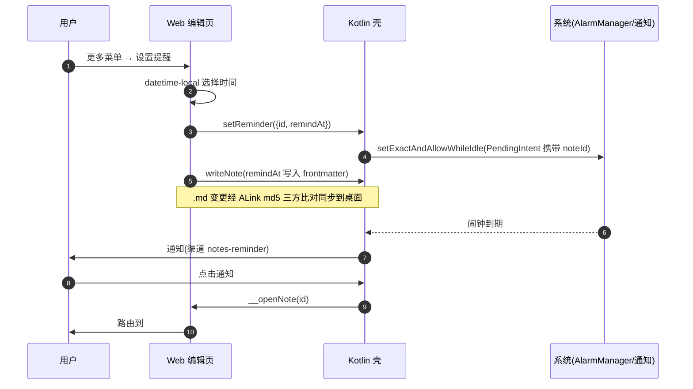

# ANotes 功能设计与 UI 规范

| 项 | 内容 |
| --- | --- |
| 版本 | v0.1 |
| 日期 | 2026-10-28 |
| 状态 | 设计稿(未实施) |
| 工程 | ANotes(Android:Kotlin WebView 壳 + Tiptap 编辑器 bundle) |
| 关联工程 | ALink(桌面互联 Electron 应用,与 ANotes 为仓库根下平级独立工程) |
| 阅读约定 | 「现状」为 2026-10-28 代码勘察结论,以代码为准;「设计」以本文档为准,均为待实施项 |

## 目录

- [1. 产品定位与功能全景](#1-产品定位与功能全景)
- [2. 架构决策:全 Web UI 化](#2-架构决策全-web-ui-化)
- [3. 数据模型与同步协议扩展](#3-数据模型与同步协议扩展)
- [4. UI 设计规范(对齐 ALink)](#4-ui-设计规范对齐-alink)
- [5. 互联体验(ANotes 与 ALink)](#5-互联体验anotes-与-alink)
- [6. P2 媒体附件(仅设计)](#6-p2-媒体附件仅设计)
- [7. 里程碑与验收](#7-里程碑与验收)
- [8. 附录:明确不做](#8-附录明确不做)

已定决策(本文档的前提,不接受翻案):

1. 媒体附件(图片/语音)放 P2 渐进,P0 先把纯文本做到厂商级。
2. 本轮只出设计文档,不实施。
3. 视觉对齐 ALink 设计语言:靛蓝主色、大圆角卡片、深浅双主题跟随系统。

---

## 1. 产品定位与功能全景

### 1.1 定位

一句话:把电脑上的 ALink 笔记库装进口袋——对标厂商备忘录的纯文本笔记体验,通过 ALink(ADB 文件同步)与桌面笔记实时互通。

三个关键词:

- **厂商级纯文本**:列表、编辑、搜索、置顶、回收站做到华为备忘录/vivo 原子笔记/小米便签/Samsung Notes/Apple Notes 的常见水准;
- **数据线级互联**:同步通道只有 ALink,桌面是主控端,手机是被同步端;
- **零外部依赖**:Android 侧不用 AndroidX/AppCompat/Material,不因功能扩张而破坏。

### 1.2 对标矩阵

竞品列基于 2026 年公开版本常见形态的粗粒度归纳,用于定优先级,不作为逐项功能承诺。

| 功能 | 华为备忘录 | vivo 原子笔记 | 小米便签 | Samsung Notes | Apple Notes | ANotes 规划 |
| --- | --- | --- | --- | --- | --- | --- |
| 列表卡片 | ✓ | ✓ | ✓ | ✓ | ✓ | **P0** |
| 摘要预览 | ✓ | ✓ | ✓ | ✓ | ✓ | **P0** |
| 搜索 | ✓ | ✓ | ✓ | ✓ | ✓ | **P0**(标题+摘要) |
| 置顶 | ✓ | ✓ | ✓ | ✓ | ✓ | **P0** |
| 颜色/分类标签 | ✓ 标签 | ✓ | ✓ 文件夹+颜色 | ✓ 分类 | 部分(文件夹) | **P0**(四色简化) |
| 回收站 | ✓ | ✓ | ✓ | ✓ | ✓(30 天) | **P0**(30 天) |
| 待办清单 | ✓ | ✓(核心交互) | ✓ | ✓ | ✓ | **P0**(编辑能力已有,补列表进度) |
| 格式工具栏 | ✓ | ✓ | ✓ | ✓ | ✓ | **P0**(接线现有 exec()) |
| 深色模式 | ✓ | ✓ | ✓ | ✓ | ✓ | **P0** |
| 多选批量操作 | ✓ | ✓ | ✓ | ✓ | ✓ | **P0** |
| 提醒通知 | ✓ | ✓ | ✓ | ✓ | ✓ | P1 |
| 分享接收 | ✓ | ✓ | ✓ | ✓ | ✓ | P1 |
| 分享出去 | ✓ | ✓ | ✓ | ✓ | ✓ | P1 |
| 跨设备同步 | 华为云 | vivo 云 | 小米云 | 三星云 | iCloud | 已有(ALink/ADB),增强 P1 |
| 图片 | ✓ | ✓ | ✓ | ✓ | ✓ | P2 |
| 语音 | ✓ | ✓(速记) | ✓ | ✓ | ✓ | P2 |
| 加密锁 | ✓ | ✓ | ✓ | ✓ | ✓ | 不做 |
| 手写/涂鸦 | ✓ | 部分 | ✓ | ✓(S Pen) | ✓(Apple Pencil) | 不做 |
| 表格 | ✓ | 部分 | ✓ | ✓ | ✓ | 不做 |

不做项的理由见 [8. 附录](#8-附录明确不做)。

### 1.3 现状与缺口

#### 1.3.1 现状(勘察结论)

| 模块 | 现状 |
| --- | --- |
| UI 壳 | 单 Activity(MainActivity.kt,281 行)纯代码构建,无 XML;垂直 LinearLayout = 顶栏(原生 Button「列表」+ 标题 TextView +「新建」)+ WebView |
| 笔记列表 | AlertDialog + ArrayAdapter 弹窗,长按物理删除;无 RecyclerView / FAB / 格式工具栏 / 菜单 |
| JS Bridge | Kotlin→JS:`__switch({id,raw})`、`__flushNow()`;JS→Kotlin:`writeNote/readNote/listNotes/deleteNote/setTitle/ready/log` |
| 热更新 | FileObserver 监听 CLOSE_WRITE\|MOVED_TO\|DELETE(仅 .md);id 等于当前笔记且距自身写入 >1.5s 才热替换,Toast 提示 |
| 存储 | `/sdcard/Android/data/com.amoolink.notes/files/notes/`(免权限);原子写 tmp+rename;id = `yyyyMMdd-HHmmss` + 5 位随机小写字母数字 |
| 编辑器 | Tiptap v3 IIFE(无 React);StarterKit(heading 仅 2/3 级、codeBlock 禁用)+ TaskList/TaskItem(可嵌套)+ Placeholder + tiptap-markdown(html:false / linkify:false) |
| exec() | 已实现 10 命令:bold / italic / strike / h2 / h3 / ul / ol / task / quote / code,但原生侧没接工具栏,用户只能靠 Markdown 输入规则 |
| frontmatter | 固定 5 字段:id / title / createdAt / updatedAt / pinned(ISO 8601 UTC);解析容错永不抛错;无标题时从正文首行派生 |
| 辅助函数 | markdownToText / noteExcerpt / noteWordCount 已存在,手机端列表未使用 |
| 样式 | android.css 仅亮色(白底 #ffffff、正文 16px/1.75、系统字体栈 PingFang SC / Noto Sans SC),无 prefers-color-scheme |
| 构建 | compileSdk 34 / minSdk 26 / targetSdk 34;**零外部依赖**(不用 AndroidX/AppCompat/Material,android.app.Activity + org.json);Manifest 无任何 uses-permission、无 LAUNCHER 之外的 intent-filter |

#### 1.3.2 缺口清单

| 能力 | 现状 | 规划 |
| --- | --- | --- |
| 搜索 | 无 | P0 |
| 置顶入口 | pinned 字段在但无 UI | P0 |
| 颜色/分类 | 无 | P0(四色) |
| 回收站 | 删即物理删 | P0 |
| 列表摘要与字数 | 辅助函数已存在但未用 | P0 |
| 待办进度(列表) | 编辑器支持,列表无展示 | P0 |
| 格式工具栏 | exec() 10 命令无入口 | P0 接线 |
| 深色模式 | 仅亮色 | P0 |
| 多选批量 | 无 | P0 |
| 设置页 | 无 | P0 |
| 返回键 | 直接退出 | P0 修 |
| WebView 链接处理 | 无 | P0 修 |
| 提醒通知 | 无 | P1 |
| 分享收发 | Manifest 无 intent-filter | P1 |
| 图片 / 语音 | 无 | P2 |

---

## 2. 架构决策:全 Web UI 化

### 2.1 决策

列表页、编辑页、回收站、设置页**全部在 WebView 内实现**,原生壳退化为「文件桥 + 系统能力」。

| 理由 | 说明 |
| --- | --- |
| 现状惯性 | 约 90% UI 已在 Web:编辑器、样式、frontmatter 序列化全在 JS 层,再拆一半回原生只会形成双轨 |
| UI 可控 | 卡片流 / chips / bottom sheet 用 Web 实现,比在零依赖约束下(无 AndroidX/Material)手写原生控件成本低一个量级 |
| 令牌复用 | 与 ALink 共用同一份设计令牌表(见 4.1),双端视觉一致性由同一套 CSS 变量保证 |
| 迭代快 | 页面逻辑与编辑器 bundle 独立于 APK 演进,构建链路不变 |

### 2.2 页面与路由

WebView 内 hash 路由,`hashchange` 驱动;冷启动/刷新按 hash 恢复。

| 路由 | 页面 | 说明 |
| --- | --- | --- |
| `#/list` | 列表 | 默认落地页:搜索 / 四色过滤 / 置顶分区 / 多选 |
| `#/edit/:id` | 编辑 | :id 为笔记 id;新建流程 = 先 writeNote 创建空笔记拿到 id,再跳转 |
| `#/trash` | 回收站 | trashedAt 非空的笔记 |
| `#/settings` | 设置 | 同步状态 / 提醒权限 / 关于 |

外部进入(通知点击、intent extra noteId、分享接收)统一经桥注入后路由到对应页面。

### 2.3 原生壳职责边界

原生壳只保留四件事:

| # | 职责 | 内容 | 新增权限 |
| --- | --- | --- | --- |
| 1 | 文件 IO 桥 | 扩展现有 Bridge(见 2.4);Kotlin 仍只读写原始 .md | 无 |
| 2 | 提醒 | AlarmManager 精确闹钟 + NotificationChannel + 通知点击直达 | P1,见 3.5 |
| 3 | 分享接收 | ACTION_SEND(text/plain)intent-filter,注入 Web | 无 |
| 4 | 系统主题/状态栏感知 | edge-to-edge,状态/导航栏染色与 icon 亮暗随主题,主题变化推送 Web | 无 |

壳层其他轻量改动(属于 WebView 配置层面,不算独立模块):

- `onBackPressed` 转发给 JS 路由回退(修现状「返回直接退出」,见 4.9);
- `shouldOverrideUrlLoading` 把 http(s) 外链交给系统浏览器。

### 2.4 桥接口

现有接口签名不变:

| 方向 | 接口 | 说明 |
| --- | --- | --- |
| Kotlin→JS | `__switch({id,raw})` | 外部变更热替换单笔记(FileObserver 路径) |
| Kotlin→JS | `__flushNow()` | 触发立即落盘 |
| JS→Kotlin | `writeNote / readNote / listNotes / deleteNote` | 笔记 CRUD |
| JS→Kotlin | `setTitle / ready / log` | 标题 / 就绪 / 日志 |

新增接口(除注明外为设计,随对应阶段实施):

| 方向 | 接口 | 说明 | 阶段 |
| --- | --- | --- | --- |
| JS→Kotlin | `setReminder({id, remindAt})` | 设/改提醒,注册精确闹钟 | P1 |
| JS→Kotlin | `cancelReminder(id)` | 取消提醒并注销闹钟 | P1 |
| JS→Kotlin | `requestNotificationPermission()` | 拉起 POST_NOTIFICATIONS 运行时授权 | P1 |
| JS→Kotlin | `shareText(text)` | ACTION_SEND 分享纯文本 | P1 |
| JS→Kotlin | `openExternal(url)` | 外链转系统浏览器 | P0 |
| JS→Kotlin | `getSystemTheme()` | 返回 dark/light,首帧主题来源之一 | P0 |
| Kotlin→JS | `__themeChange(dark)` | 系统主题变化推送 | P0 |
| Kotlin→JS | `__openNote(id)` | intent extra / 通知点击直达指定笔记 | P1 |
| Kotlin→JS | `__shareReceived(text)` | 分享接收注入(新建笔记) | P1 |

**约束**:frontmatter 序列化只在 JS 层;Kotlin 不感知字段语义,org.json 仅用于桥消息封装(与现状一致)。

### 2.5 依赖与构建约束(不变项)

- 零外部依赖:不引入 AndroidX/AppCompat/Material,继续 android.app.Activity + org.json;
- compileSdk 34 / minSdk 26 / targetSdk 34 不变;
- Kotlin 只读写原始 .md,原子写 tmp+rename 不变;
- 新增权限只随 P1 提醒/分享进入 Manifest,P0 保持零 uses-permission。

---

## 3. 数据模型与同步协议扩展

### 3.1 frontmatter v2 字段表

在现有 5 字段上新增 3 个字段,合称 frontmatter v2:

| 字段 | 类型 | 必有 | 说明 |
| --- | --- | --- | --- |
| id | string | 是 | `yyyyMMdd-HHmmss` + 5 位随机小写字母数字,创建后不变 |
| title | string | 是 | 空则由正文首行派生(现状规则) |
| createdAt | ISO 8601 UTC | 是 | 创建时间 |
| updatedAt | ISO 8601 UTC | 是 | 修改时间 |
| pinned | boolean | 是 | 置顶;桌面 `amoolink:notes:pin` 语义不变 |
| color | `"default" \| "blue" \| "green" \| "amber"` | v2 起 | 笔记颜色;缺省按 default |
| trashedAt | ISO 8601 UTC \| null | v2 起 | null/缺失 = 未删除;非空 = 在回收站 |
| remindAt | ISO 8601 UTC \| null | v2 起 | null/缺失 = 无提醒;手机侧触发通知 |

写入规则:

- 固定顺序:`id, title, createdAt, updatedAt, pinned, color, trashedAt, remindAt`;
- 新写入一律 8 字段全量;时间统一 ISO 8601 UTC(沿用现状);
- 旧文件(5 字段)读到缺失字段按缺省值处理(color=default、trashedAt=null、remindAt=null),首次保存时补齐。

### 3.2 读写兼容

- **读**:解析容错永不抛错(现状);color 非法值按 default;trashedAt / remindAt 非法或无法解析按 null;
- **写**:v2 字段读写全部在 JS 层;updatedAt 任何保存必刷新;
- **跨端**:ALink 桌面当前只认识 5 字段——桌面保存必须透传未知 frontmatter 字段,否则桌面一保存即丢 v2 字段。此为 ALink 侧 P1 必改项(见 3.6)。

### 3.3 回收站与同步协议

核心原则:**回收站不动同步协议**。trashedAt 属于 .md 内容变更,天然走现有 md5 三方比对;manifest 结构、tombstone、TTL 全部沿用。

| 动作 | 手机行为 | 同步表现 |
| --- | --- | --- |
| 移入回收站 | writeNote 写 trashedAt=now | 普通 .md 变更,双端可见(桌面过滤展示,P1) |
| 恢复 | trashedAt=null | 同上 |
| 彻底删除 | 物理删 .md(现有 deleteNote) | 桌面按「远端缺失」分支收敛为 tombstone(与现状手机删除路径一致) |
| 清空回收站 | 逐个物理删 + 二次确认 | 同上 |
| 30 天 TTL | trashedAt 起算,到期自动物理删 | 同上;与 tombstone TTL 30 天对齐 |

同步协议现状(ANotes 不改,摘录 ALink 事实,保证本文自洽):

- 桌面库 `userData/notes/*.md`;手机目录 `/sdcard/Android/data/com.amoolink.notes/files/notes/` + 同目录 manifest.json;
- manifest:`{version:1, notes:{ [id]: {md5, mtime, deletedAt|null} }}`;md5 为全文 utf8;deletedAt 即 tombstone,TTL 30 天后清出;
- **manifest.json 由桌面 ALink 写入维护,手机端不写**,避免双端并发写。

planSync 决策表(现状):

| 情形 | 决策 |
| --- | --- |
| 双方 md5 相同 | noop |
| 本地缺失 + 远端 tombstone | noop |
| 本地 tombstone + 远端 ≠ base | conflict |
| 本地 tombstone + 远端 = base | delete-remote |
| 远端缺失 / 远端 tombstone | 与上两行对称(角色互换) |
| 双在且 md5 不同 | base === local → pull;base === remote → push;否则 conflict |

冲突处理(现状,手机侧呈现见 5.3):本地内容另存新 id,标题 + `-冲突-yyyyMMdd-HHmm`,远端占原 id。

同步运行事实(现状):轮询 5s;第一台 state==='device' 的设备上线自动开表;autoSync 默认开;一次只同步一台;同步状态胶囊 idle / scanning / syncing↑n↓n / done / error。

### 3.4 提醒链路(P1)



| 规则 | 说明 |
| --- | --- |
| 元数据随 .md 同步 | remindAt 在 frontmatter,双端可见;桌面只读展示(P1 配套) |
| 通知只在手机触发 | 桌面不设闹钟 |
| 改期 / 取消 | 走桥重设 / 注销闹钟,与 writeNote 同步完成,双端一致 |
| 已过期提醒 | 打开笔记时发现 remindAt < now:清空字段并 Toast「提醒已过期」 |
| 精确闹钟降级 | API 31+ `canScheduleExactAlarms()` 为 false 时改 setWindow 近似触发,设置页引导授权 |
| 开机重排 | BOOT_COMPLETED 后按未到期 remindAt 重注册(P1 可选项) |

权限表(targetSdk 34 语境):

| 权限 | 声明 | 授予方式 | 时机 |
| --- | --- | --- | --- |
| POST_NOTIFICATIONS(API 33+) | uses-permission | 运行时申请(targetSdk 34 必须) | 首次设置提醒时;拒绝则设置页引导 |
| SCHEDULE_EXACT_ALARM | uses-permission | 特殊权限,API 31+ 默认未授予 | 静态声明;运行时检查并降级 |
| RECEIVE_BOOT_COMPLETED | uses-permission | 静态 | P1 可选(开机重排) |

NotificationChannel:渠道 id `notes-reminder`,minSdk 26 即要求渠道,创建于首次设置提醒。

### 3.5 分享收发(P1)

| 方向 | 方案 |
| --- | --- |
| 接收 | Manifest 增加 ACTION_SEND(text/plain)intent-filter;MainActivity 需声明 singleTask 以便运行中经 onNewIntent 接收(设计项);EXTRA_TEXT → `__shareReceived(text)` → 新建笔记并进入编辑 |
| 发出 | 编辑页更多菜单「分享文本」→ `shareText(标题+正文纯文本)` → 系统 ACTION_SEND |

### 3.6 ALink 桌面侧配套(仅设计,本轮不动 ALink 代码)

| 项 | 内容 | 说明 |
| --- | --- | --- |
| 列表过滤 | `amoolink:notes:list` 结果与同步展示过滤 trashedAt ≠ null | 手机移入回收站后,桌面列表即时消失 |
| 桌面回收站入口 | 列出 trashedAt ≠ null 的笔记,支持桌面恢复/彻底删 | 与手机语义一致 |
| 保存保留未知字段 | 桌面保存 .md 时透传 color / trashedAt / remindAt | **必改**:否则桌面保存即丢 v2 字段(见 3.2) |
| 「在手机上打开」 | 桌面笔记页逐笔记入口(编辑区工具位 / 列表项菜单),执行 `adb am start -n com.amoolink.notes/.MainActivity --es noteId <id>` | 手机端读 extra → `__openNote`;需两端配合,P1 |
| 降级路径 | 不支持 extra 的旧手机包退回 `monkey -p <pkg> -c android.intent.category.LAUNCHER 1`(现有先例) | 仅打开 App,不定位笔记;am start deep link 目前无先例 |
| 提示 | 手机未解锁 / 未授权 USB 调试时给出降级文案 | 复用现有设备状态展示 |
| 同步状态条 | 复用现有胶囊(idle / scanning / syncing↑n↓n / done / error) | 不新增 |

推送通道沿用现状 IPC:推送 `notes:changed` / `notes:state`;通道全集 `amoolink:notes:list/get/create/save/pin/remove/sync-now/state/install-app`。

---

## 4. UI 设计规范(对齐 ALink)

### 4.1 设计令牌平移表

ALink 暗色为默认,`prefers-color-scheme: light` 切亮色;下表整表平移为 ANotes CSS 自定义属性(`--an-*`),暗/亮两套完整色值:

| ALink 变量 | ANotes 变量 | 用途 | 暗色(默认) | 亮色 |
| --- | --- | --- | --- | --- |
| --color-bg | --an-bg | 页面底色 | #0e0f13 | #f7f8fa |
| --color-bg-elevated | --an-elevated | 浮层 / 弹层 / Toast | #14151a | #ffffff |
| --color-surface | --an-surface | 卡片 / 输入框 | #191b21 | #ffffff |
| --color-surface-hover | --an-hover | 悬浮 / 按压浅 | #212329 | #eef0f4 |
| --color-surface-active | --an-active | 按压深 | #26282f | #e6e9ef |
| --color-border | --an-border | 常规描边 | #262932 | #e4e6ec |
| --color-border-strong | --an-border-strong | 强描边 / 分隔 | #353a47 | #d3d7e0 |
| --color-text-primary | --an-text | 主文字 | #e9eaee | #1a1d26 |
| --color-text-secondary | --an-text-2 | 次文字 / 摘要 | #a6a9b4 | #5f6370 |
| --color-text-tertiary | --an-text-3 | 弱文字 / 占位 / 时间 | #6f7383 | #9aa0ac |
| --color-accent | --an-accent | 主色靛蓝(参考 Linear) | #6b76f2 | #545ce8 |
| --color-accent-hover | --an-accent-hover | 主色悬停 | #818cf8 | #6a73ef |
| --color-accent-text | --an-accent-text | 靛蓝文字 | #a2abff | #3f47c9 |
| --color-accent-subtle | --an-accent-subtle | 靛蓝浅底 | rgba(107,118,242,.15) | rgba(84,92,232,.10) |
| --color-accent-border | --an-accent-border | 靛蓝描边(选中态) | rgba(107,118,242,.4) | rgba(84,92,232,.35) |
| --color-on-accent | --an-on-accent | accent 底上的文字 / 图标 | #ffffff | #ffffff |
| --color-success | --an-success | 成功 / 待办完成 | #2fae74 | #2fae74 |
| --color-success-text | --an-success-text | 成功文字 | #55cf9a | #1d8a58 |
| --color-success-bg | --an-success-bg | 成功浅底 | rgba(47,174,116,.14) | rgba(47,174,116,.10) |
| --color-warning | --an-warning | 警示 / 琥珀笔记 | #de9b35 | #de9b35 |
| --color-warning-text | --an-warning-text | 警示文字 | #f0b45a | #a8731f |
| --color-warning-bg | --an-warning-bg | 警示浅底 | rgba(222,155,53,.14) | rgba(222,155,53,.10) |
| --color-danger | --an-danger | 危险 / 删除 | #e2606c | #e2606c |
| --color-danger-text | --an-danger-text | 危险文字 | #f2818c | #c23e4b |
| --color-danger-bg | --an-danger-bg | 危险浅底 | rgba(226,96,108,.14) | rgba(226,96,108,.10) |

暗色整列取自 ALink `tokens.css` 实值;**亮色列为 ANotes 自定方案**(ALink 当前仅亮色主色 #545ce8 有定值),后续 ALink 若定义完整亮色主题应回改对齐。ALink 另有 `--shadow-pop/overlay`、`--color-scrollbar`、skeleton 等令牌,P0 暂不搬,实施时按需平移。

主题机制:

- CSS 变量定义两套:`:root`(暗,默认)与 `[data-theme="light"]`(亮);
- 主题来源以桥为准:启动读 `getSystemTheme()` 置 `data-theme`,此后 `__themeChange(dark)` 跟随;`@media (prefers-color-scheme: light)` 仅作无桥兜底,`data-theme` 优先;
- 字体栈沿用现状:system-ui + PingFang SC / Noto Sans SC;编辑器正文维持 16px/1.75 不变(UI 令牌不反向约束编辑器排版)。

### 4.2 其他令牌

圆角(继承 ALink 五档,vivo 风向大圆角倾斜):

| 值 | 用途 |
| --- | --- |
| 5px | 小徽标、分隔件 |
| 8px | 按钮、输入框、搜索栏 |
| 12px | 菜单、小面板 |
| 16px | 列表卡片、FAB、bottom sheet 顶角 |
| 999px | 胶囊 chips、状态胶囊 |

字号(对应 ALink `--font-size-*` 六档;编辑器正文 16px 为现状例外):

| px | ALink 变量 | 用途 |
| --- | --- | --- |
| 11 | --font-size-xs | 徽标、时间戳 |
| 12 | --font-size-sm | 底栏元信息、Toast |
| 13 | --font-size-md | 列表摘要、辅助文本 |
| 15 | --font-size-lg | 按钮文字、次级正文 |
| 18 | --font-size-xl | 卡片标题、页面小标题 |
| 24 | --font-size-xxl | 页面大标题(「笔记」「回收站」「设置」) |

间距:4px 基数,常用 4 / 8 / 12 / 16 / 20 / 24 / 32;页面左右安全边距 16px。

动效:

| 时长 | 场景 |
| --- | --- |
| 120ms | 按压反馈、chips 切换 |
| 200ms | Toast 进出、置顶/变色即时反馈 |
| 320ms | bottom sheet、页面路由过渡 |

笔记四色(frontmatter `color` 与 UI 色点一一对应):

| 值 | 色点 | 说明 |
| --- | --- | --- |
| default | 无色点(灰描边圆点) | 缺省 |
| blue | #5b8def | |
| green | #2fae74 | 复用 success |
| amber | #de9b35 | 复用 warning |

vivo 风要素落地:大圆角卡片(16px)+ 胶囊 chips(999px)+ accent 渐变 squircle 图标(FAB 与空状态插画用 accent → accent-hover 45° 渐变)+ 克制靛蓝(仅主操作用 accent)+ 待办清单核心交互(列表卡片展示待办进度)。

### 4.3 全局组件

| 组件 | 规格 |
| --- | --- |
| 按钮 primary | accent 底白字,8px 圆角,高 40px;按压态 --an-accent-hover |
| 按钮 ghost | 透明底 + 1px --an-border,文字 --an-text |
| 按钮 danger | danger 底白字,仅彻底删除/清空/批量删除确认 |
| 卡片 | --an-surface 底,16px 圆角,1px --an-border,内边距 16px,卡片间距 12px |
| 色点 chips | 999 胶囊,高 32px;选中态 --an-accent-subtle 底 + --an-accent-text 字 |
| FAB | 56×56,16px 圆角,accent 渐变底,右下 24px,--an-elevated + 阴影 |
| 搜索栏 | --an-surface 底,8px 圆角,高 40px,占位「搜索标题与摘要」 |
| 空状态 | 居中:squircle 渐变插画位 + 标题(18px)+ 两行说明(13px)+ 主按钮 |
| Toast | 底部上浮,--an-elevated 底,12px 字,200ms 进出,默认 2.5s 消失 |
| bottom sheet | Web 实现:全屏遮罩 rgba(0,0,0,.5)+ 底部面板 --an-elevated,顶角 16px,320ms 上滑;下滑 / 点遮罩关闭 |

### 4.4 列表页

```
┌──────────────────────────────────────────────┐
│  (状态栏:随主题染色)                       │
│                                              │
│  笔记                              12 篇     │
│  ┌────────────────────────────────────────┐  │
│  │  搜索标题与摘要                        │  │
│  └────────────────────────────────────────┘  │
│  (全部) (默认) (蓝) (绿) (琥珀)             │
│                                              │
│  置顶                                        │
│  ┌────────────────────────────────────────┐  │
│  │ 项目周会纪要                        O  │  │
│  │ 本周结论:接口联调完成,测试下周……     │  │
│  │ 昨天 14:30 - 待办 3/5                  │  │
│  └────────────────────────────────────────┘  │
│  全部笔记                                    │
│  ┌────────────────────────────────────────┐  │
│  │ 购物清单                               │  │
│  │ 牛奶、鸡蛋、全麦面包……                 │  │
│  │ 周一 - 待办 1/2                        │  │
│  └────────────────────────────────────────┘  │
│  ┌────────────────────────────────────────┐  │
│  │ 灵感随手记                        冲突 │  │
│  │ 便签类产品对标:华为备忘录的提醒……     │  │
│  │ 10-20                                  │  │
│  └────────────────────────────────────────┘  │
│                                              │
│                                          +-+ │
│                                          |+| │
│                                          +-+ │
└──────────────────────────────────────────────┘
```

(FAB = 右下角 `+`,accent 渐变;卡片右上 `O` 为色点位,`冲突` 为徽标示例。)

| 规则 | 说明 |
| --- | --- |
| 分区 | 置顶分区在前,普通分区在后;分区内 updatedAt 倒序(与桌面一致) |
| 卡片内容 | 标题(无标题 → 正文首行派生)/ 两行摘要(noteExcerpt,超出省略)/ 相对时间 / 色点 / 待办进度 n/m |
| 待办进度 | 正文 TaskList 统计:已完成 m / 总数 n;无待办则不显示 |
| 过滤 | 四色 chips:全部 / 默认 / 蓝 / 绿 / 琥珀;与搜索叠加(AND) |
| 搜索 | title + excerpt 包含匹配,500ms 防抖(与桌面同参,便于复用同一搜索函数) |
| 点击 | 进入 `#/edit/:id` |
| 长按 | 进入多选;顶栏变 全选 / 移入回收站 / 取消 |
| 滑动 | 左滑快捷移入回收站为**可选**增强,P0 不做(避免与长按多选手势冲突) |

多选模式:

```
┌──────────────────────────────────────────────┐
│  取消          已选 3 篇        全选 | 删除  │
│  ┌────────────────────────────────────────┐  │
│  │ [x] 项目周会纪要                       │  │
│  └────────────────────────────────────────┘  │
│  ┌────────────────────────────────────────┐  │
│  │ [x] 购物清单                           │  │
│  └────────────────────────────────────────┘  │
│  ┌────────────────────────────────────────┐  │
│  │ [ ] 灵感随手记                         │  │
│  └────────────────────────────────────────┘  │
└──────────────────────────────────────────────┘
```

(「删除」= 批量移入回收站,点击后二次确认;多选状态下过滤与搜索冻结。)

| 列表页状态 | 呈现 |
| --- | --- |
| 无笔记 | 空状态组件(见 5.4 文案) |
| 搜索/过滤无结果 | 「没有匹配「xx」的笔记」+「清除搜索」ghost 按钮 |
| 全部在回收站 | 同空状态,说明改为「笔记都在回收站里」 |

与桌面 Notes 页(264px 列表 + 编辑区 grid)的视觉对应:

| 手机 | 桌面 |
| --- | --- |
| 卡片 = 色点 + 标题 + 两行摘要 + 相对时间(+待办进度) | 列表项 = 置顶徽标 / 标题 / 两行摘要 / 相对时间 / hover 置顶删除 |
| 四色过滤 chips | 桌面暂无(P1 可加同款过滤) |
| 大标题「笔记」+ 计数 | — |
| FAB 新建 | 编辑区新建入口 |
| 置顶分区 + updatedAt 倒序 | 置顶优先 + updatedAt 倒序(一致) |

### 4.5 编辑页

```
┌──────────────────────────────────────────────┐
│  <- 列表     O   置顶   提醒   ...           │
│                                              │
│  大标题输入区(无边框,placeholder「标题」) │
│                                              │
│  正文编辑区(Tiptap)                       │
│  支持 Markdown 输入规则,工具栏即时生效……   │
│                                              │
│                                              │
├──────────────────────────────────────────────┤
│  B  I  S | H2  H3 | 无序 有序 待办 | 引用 `  │
├──────────────────────────────────────────────┤
│  328 字                        保存于 2 分钟前│
└──────────────────────────────────────────────┘
```

| 区块 | 规格 |
| --- | --- |
| 返回栏 | `<-` 返回列表;右侧依次:色点(打开颜色四选)、置顶开关、提醒、`...` 更多(bottom sheet) |
| 大标题 | 无框大标题(对齐桌面编辑区),placeholder「标题」;为空时保存由正文首行派生(现状规则),一旦手动输入即以输入为准 |
| 格式工具栏 | 编辑区底部固定条,横滑可扩展;与桌面工具栏同序:B/I/S \| H2/H3 \| 无序/有序/待办 \| 引用/行内码 |
| 正文 | Tiptap 现状配置不变(heading 2/3 级、codeBlock 禁用、TaskList 可嵌套、tiptap-markdown html:false/linkify:false) |
| 底栏 | 左:字数(noteWordCount);右:保存于 xx 前(相对时间) |

工具栏接线映射(exec() 已实现,P0 只补 UI 入口):

| 按钮 | exec() 命令 |
| --- | --- |
| B / I / S | bold / italic / strike |
| H2 / H3 | h2 / h3 |
| 无序 / 有序 / 待办 | ul / ol / task |
| 引用 / 行内码 | quote / code |

保存链路:输入 500ms 防抖(与桌面一致)→ writeNote → Kotlin 原子写 tmp+rename;离开页面前 `__flushNow()` 立即落盘(现状已有)。

更多菜单(bottom sheet):

| 行 | 行为 |
| --- | --- |
| 颜色 | 四选:默认 / 蓝 / 绿 / 琥珀;点选即写 color,面板保持展开便于连选 |
| 置顶 | 开关,写 pinned |
| 提醒 | 行尾显示当前值(「未设置」或时间);点击弹 datetime-local 时间选择器 → setReminder + remindAt;已有提醒可改期 / 移除(P1) |
| 移入回收站 | danger 色,写 trashedAt 后返回列表 |
| 分享文本 | shareText(标题 + 正文纯文本)(P1) |

冲突副本呈现:标题含 `-冲突-yyyyMMdd-HHmm` 的笔记,在列表标题旁与编辑页大标题旁加「冲突」徽标(--an-accent-subtle 底);处理指引见 5.3。

### 4.6 回收站页

```
┌──────────────────────────────────────────────┐
│  <- 回收站                        清空       │
│  (i) 移入回收站的笔记 30 天后自动彻底删除   │
│  ┌────────────────────────────────────────┐  │
│  │ 旧版方案草稿                           │  │
│  │ 删于 10-21 09:12      [恢复] [彻底删除]│  │
│  └────────────────────────────────────────┘  │
│  ┌────────────────────────────────────────┐  │
│  │ 会议记录-1024                          │  │
│  │ 删于 3 天前           [恢复] [彻底删除]│  │
│  └────────────────────────────────────────┘  │
└──────────────────────────────────────────────┘
```

| 规则 | 说明 |
| --- | --- |
| 列表 | trashedAt 非空,按 trashedAt 倒序 |
| 行内容 | 标题 / 「删于 <trashedAt 相对时间>」 |
| 行操作 | 恢复(trashedAt=null);彻底删除(物理删,二次确认) |
| 页级操作 | 清空(二次确认,逐个物理删) |
| TTL 提示条 | 顶部常驻:30 天自动彻底删除 |
| 搜索 | 不提供(回收站保持从简,与竞品一致) |

### 4.7 设置页

```
┌──────────────────────────────────────────────┐
│  <- 设置                                     │
│  同步                                        │
│  ┌────────────────────────────────────────┐  │
│  │ 上次从电脑更新      3 分钟前           │  │
│  │ 本机最近写入        刚刚               │  │
│  │ [ 立即落盘并刷新 ]                     │  │
│  └────────────────────────────────────────┘  │
│  提醒                                        │
│  ┌────────────────────────────────────────┐  │
│  │ 通知权限            已允许 >           │  │
│  │ 精确闹钟            已允许 >(API 31+) │  │
│  └────────────────────────────────────────┘  │
│  关于                                        │
│  ┌────────────────────────────────────────┐  │
│  │ 版本 / 存储位置说明 / 同步说明         │  │
│  └────────────────────────────────────────┘  │
└──────────────────────────────────────────────┘
```

| 区块 | 说明 |
| --- | --- |
| 同步 | 同步由桌面 ALink 主导(5s 轮询、一次一台),**手机端不感知桌面连接状态**,只展示可观测事实:上次被外部写入时间(FileObserver)、本机最近写入时间;按钮 = `__flushNow()` 立即落盘并刷新展示(P1 起同步状态展示完善) |
| 提醒 | 通知权限状态与跳转系统设置;精确闹钟授权引导(API 31+,canScheduleExactAlarms=false 时显示) |
| 关于 | 版本、存储路径说明、ALink 同步一句话说明 |

### 4.8 深浅色与系统栏

- 双主题:见 4.1;暗色为默认兜底,亮色由 `data-theme="light"`(桥推送)或 prefers-color-scheme(兜底)激活;
- 状态栏 / 导航栏:edge-to-edge,背景色 = --an-bg,与页面连成一体;icon 亮暗随主题(暗主题用浅色 icon,亮主题用深色 icon);
- API 分支:26–29 用 systemUiVisibility 的 LIGHT_STATUS_BAR / LIGHT_NAVIGATION_BAR;30+ 用 WindowInsetsController 的 APPEARANCE_LIGHT_STATUS_BARS / APPEARANCE_LIGHT_NAVIGATION_BARS;
- 软键盘:adjustResize,编辑页正文区随键盘压缩,工具栏贴键盘顶部。

### 4.9 交互细节

返回键策略(修现状「back 直接退出」):

| 当前状态 | 返回键行为 |
| --- | --- |
| bottom sheet / Toast 带撤销 / 多选模式 | 先关闭该层,不走路由 |
| `#/edit/:id` | 先 `__flushNow()`,再返回 `#/list` |
| `#/trash` / `#/settings` | 返回 `#/list` |
| `#/list`(根) | 系统默认(退到桌面) |

实现:`onBackPressed` → `evaluateJavascript("__routeBack()")`;JS 返回已消费则拦截,否则走系统默认。零依赖约束下沿用 Activity.onBackPressed(不引入 OnBackPressedDispatcher)。

Toast 场景清单:

| 场景 | 文案 |
| --- | --- |
| 同步热替换(现状保留) | 「已从电脑同步更新」 |
| 移入回收站(单个/批量) | 「已移入回收站」+「撤销」按钮(5s) |
| 恢复 | 「已恢复」 |
| 彻底删除 / 清空 | 「已彻底删除」/「回收站已清空」 |
| 设 / 改 / 取消提醒(P1) | 「将于 xx 提醒」/「已取消提醒」 |
| 提醒已过期 | 「提醒已过期,已清除」 |
| 冲突副本产生 | 「检测到冲突,已保留两个版本」 |

---

## 5. 互联体验(ANotes 与 ALink)

### 5.1 现状体验

- 桌面改、手机即时可见:ALink 写手机目录 → FileObserver(CLOSE_WRITE|MOVED_TO|DELETE,仅 .md)→ id 等于当前笔记且距自身写入 >1.5s → `__switch({id,raw})` 热替换 + Toast;
- 手机写、桌面拉走:writeNote 原子写 → 桌面 5s 轮询 md5 三方比对 → 同步状态胶囊(idle / scanning / syncing↑n↓n / done / error);
- 该双通道体验 P0 原样保留,Web 化后仅承载层从整页 WebView 变为路由内页面。

### 5.2 增强

| 项 | 说明 | 阶段 |
| --- | --- | --- |
| 设置页同步状态 | 上次从电脑更新 / 本机最近写入(见 4.7) | P0 简版,P1 完善 |
| 桌面过滤回收站 | trashedAt ≠ null 不出现在桌面列表;桌面回收站入口 | P1 |
| 「在手机上打开」 | 见 3.6,`adb am start -n ... --es noteId <id>` | P1 |
| 冲突指引 | 见 5.3 | P0 呈现,P1 指引文案完善 |

### 5.3 冲突双副本的呈现与处理

- **产生**:双端都改同一笔记且 planSync 判 conflict → 手机侧本地内容另存新 id,标题 + `-冲突-yyyyMMdd-HHmm`,远端(电脑)内容占原 id;
- **呈现**:列表卡片与编辑页大标题旁显示「冲突」徽标;正文不做任何标记,标题后缀原样保留;
- **处理指引**(编辑页更多菜单底部固定一行说明):推荐在桌面把两份内容合并入原 id 笔记,然后手机端把 `-冲突-` 副本移入回收站;也可以直接保留副本手动整理;
- 冲突副本与普通笔记走完全相同的四色 / 置顶 / 回收站流程,不引入特殊状态机。

### 5.4 安装引导与首次启动

- 桌面「装到手机」按钮已有(IPC `amoolink:notes:install-app`);APK 来源:打包态 `resources/android/AmooNotes.apk`,开发态指 ANotes 仓库构建产物;
- 手机端首次启动且无笔记 → 空状态文案:
  - 标题:「还没有笔记」
  - 说明:「在电脑上打开 ALink,数据线连接后会自动同步;也可以在这里直接新建。」
  - 主按钮:「新建笔记」
- 空状态在 P0 即落地,是安装引导闭环的最后一环(用户装完打开就能看懂下一步)。

---

## 6. P2 媒体附件(仅设计,本轮不实施)

### 6.1 存储与 manifest 扩展

- 附件目录:`notes/assets/{noteId}/`,与 .md 同级;
- 正文以相对引用:`` / 语音 ``;
- manifest 扩展(设计):`notes[id]` 增加 `assets: { [filename]: md5 }`,仍由桌面维护;彻底删除笔记时按 `assets/{noteId}/` 整目录双端清理。

### 6.2 图片链路

编辑页工具栏「图片」→ `ACTION_GET_CONTENT(image/*)` → 桥 `copyIntoAssets(noteId, uri)` 拷贝入附件目录 → JS 插入 Tiptap Image 节点(相对 src);Tiptap Image 扩展作为 P2 bundle 增量引入。

### 6.3 语音链路

MediaRecorder → m4a → 附件目录;正文内联 `<audio>` 播放;录制中显示计时与停止控件。

### 6.4 同步协议扩展与风险

| 风险 | 说明 |
| --- | --- |
| 二进制 md5 | 现同步仅按文本 utf8 md5;二进制需流式计算,桌面 planSync 需扩展分支 |
| 大文件 | ADB 推拉大文件耗时长,需同步进度展示与单文件尺寸上限 |
| 孤儿附件 | 删除引用后文件残留,需以正文引用扫描为准做 GC |
| 桌面预览 | Electron 侧需相应渲染图片/音频,成本在 ALink 侧 |
| 免权限边界 | assets 目录仍在 app 专属 external files 下,免权限成立;但跨端路径约定新增,易错 |

**结论**:本轮不实施;P0/P1 仅冻结目录约定与相对引用格式,避免正文格式日后反悔。

---

## 7. 里程碑与验收

### 7.1 阶段划分

| 阶段 | 范围 |
| --- | --- |
| P0 | Web 化重构(hash 路由 + 列表/编辑/回收站/设置四页);列表卡片(摘要/相对时间/色点/待办进度);搜索;置顶;四色;回收站全流程(移入/恢复/彻底删除/清空/30 天 TTL);工具栏接线(exec 10 命令);深浅双主题;返回键路由回退;多选批量;外链处理;空状态 |
| P1 | 提醒(权限/闹钟/通知直达/改期取消/开机重排可选);分享接收与分享文本;ALink 配套(桌面 trashedAt 过滤、桌面回收站、保存保留未知字段、「在手机上打开」);设置页同步状态完善 |
| P2 | 图片、语音附件(按第 6 节设计) |

### 7.2 验收标准

| 层 | 标准 |
| --- | --- |
| 单测(editor 包 vitest) | frontmatter v2 读写兼容(旧 5 字段文件无损升级);trashedAt TTL 计算;搜索/四色过滤纯函数;hash 路由解析;待办进度统计 |
| 构建 | `gradle assembleDebug` 通过;零外部依赖约束不破坏(依赖树无 AndroidX/Material);Manifest 权限与阶段一致(P0 零 uses-permission) |
| 真机 e2e | 沿用 ALink 侧 e2e-notes.sh 的 adb 脚本模式:新建 → 编辑 → 置顶 → 改色 → 移入回收站 → 恢复 → 彻底删除 → 桌面同步往返 |
| 厂商走查(P0 专项) | 对照华为备忘录 / vivo 原子笔记 / 小米便签 / Samsung Notes / Apple Notes 截屏,逐屏核对列表 / 编辑 / 回收站的信息密度与操作路径 |
| 同步用例 | 双端同时改同一笔记 → 手机出现 `-冲突-` 副本且原 id 内容为远端版本;桌面保存 v2 笔记后字段不丢(P1 配套完成后验证) |

---

## 8. 附录:明确不做

| 项 | 理由 |
| --- | --- |
| 手写/涂鸦 | 需笔迹矢量数据与画布栈,.md 纯文本存储无法承载;竞品依赖手写笔硬件生态,投入产出不匹配 |
| 表格 | Tiptap Table 与 markdown 表格序列化往返易损(合并单元格等),与 tiptap-markdown(html:false)相性差;与「纯文本优先」冲突 |
| 笔记加密锁 | 加密内容无法参与 md5 三方比对,破坏 ALink 同步契约;「本地加密 + 同步排除」会制造双轨状态 |
| 云同步 | 同步通道只保留 ALink(ADB),不引入第三方云账号与网络依赖 |
| 多人协作 | 无服务端,超出「单机 + 数据线互联」的产品边界 |
| 桌面小组件 | AppWidget 需原生 UI 栈,与全 Web UI 架构冲突;且非互联核心路径 |

---

文档结束。与本文档冲突的早期口头约定一律以本文档「已定决策」一节为准;实施中发现设计缺口,先更新本文档再动代码。
